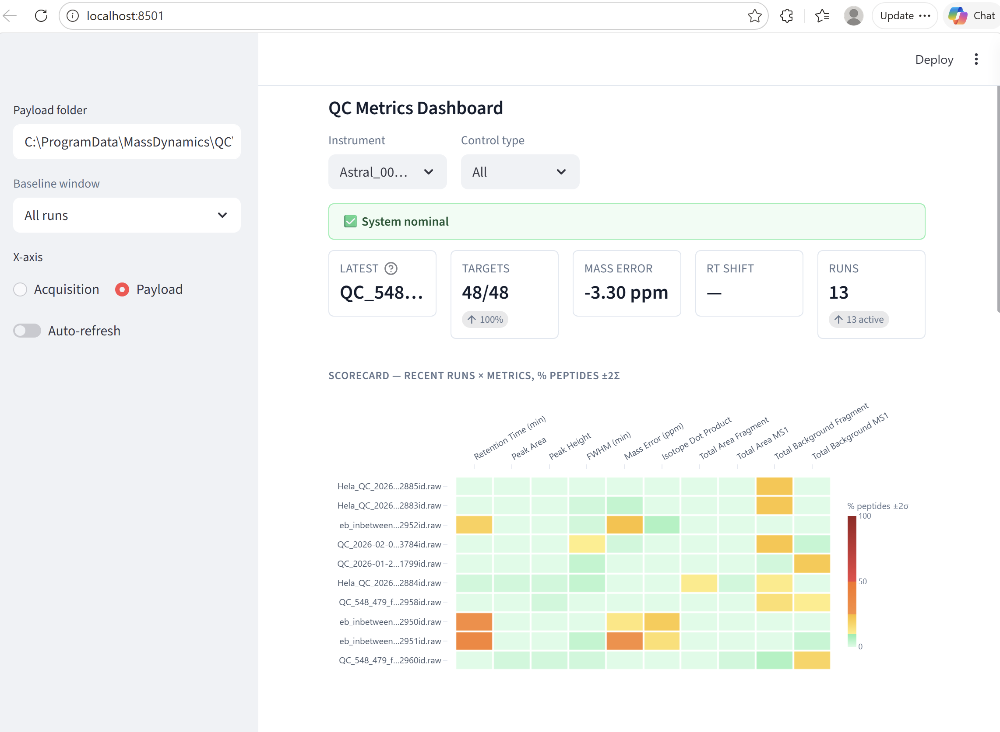

# MD QC Agent

[](https://github.com/MassDynamics/md-qc/releases/latest)
[](./LICENSE)

**Automated quality-control monitoring for mass-spectrometry instruments.**

A small background service that watches your acquisition folder, runs targeted
Skyline extractions on every new raw file, and turns each run into a structured
QC payload — designed for operators who want to spot chromatography drift,
calibration shifts, and sample-prep issues *before* they contaminate weeks of
data.

Built by [Mass Dynamics](https://massdynamics.com). MIT-licensed.


*The agent's own web UI: service state, upload queue, configured instruments,
and the most recent extractions. Longer-range trend analysis lives in the Mass
Dynamics platform.*

---

## What it does

- **Watches** any folder containing raw files (Thermo, Sciex, Bruker, Agilent)
- **Detects** stable files (configurable size/mtime quiescence window) and
  classifies them by filename: PCD (process control digest, 96- or
  384-well kit) / SSC (system suitability control) / SSC-gold / blank / sample
- **Extracts** per-peptide QC metrics with a real Skyline run — no copies,
  no proxies, the same numbers an analyst would get manually
- **Scores** each run against a gold-standard baseline you record in the web
  UI: per-peptide ratios, deviations and a peak-area verdict travel with the
  payload, alongside the raw measurements they were derived from
- **Spools** results to disk as structured JSON payloads, with optional
  upload to the Mass Dynamics platform
- **Reports** locally in the agent's web UI — dashboard, gold standards,
  diagnostics, failed files, logs

The whole thing runs **locally** — no cloud connection is required for the
core monitoring loop.

---

## Quick start

### Install

Windows, with [Python 3.11 or newer](https://www.python.org/downloads/)
installed. In PowerShell, as the user who uses the instrument PC:

```powershell
Invoke-WebRequest -UseBasicParsing https://raw.githubusercontent.com/MassDynamics/md-qc/v1.2.0/scripts/install.ps1 -OutFile install.ps1
powershell -ExecutionPolicy Bypass -File install.ps1
```

The script installs into `C:\MassDynamics\mdqc`, makes the agent and its tray
icon start at login with no window, adds Start-menu shortcuts, and starts it.
Re-run it to upgrade; `-Uninstall` removes it. Options (a Windows service,
another release) are in [docs/INSTALL.md](./docs/INSTALL.md#3-install-the-agent).

By hand, everything goes in one virtual environment:

```powershell
py -3 -m venv C:\MassDynamics\mdqc
C:\MassDynamics\mdqc\Scripts\pip install "mdqc[tray] @ https://github.com/MassDynamics/md-qc/archive/refs/tags/v1.2.0.tar.gz"
C:\MassDynamics\mdqc\Scripts\mdqc version
```

Calling the environment's `pip` and `mdqc` by path avoids activating it, so
there is no PowerShell execution-policy change to argue about with IT. If you
prefer to activate it, `C:\MassDynamics\mdqc\Scripts\Activate.ps1` then plain
`pip` and `mdqc` work as usual.

**From source**, for development:

```powershell
git clone https://github.com/MassDynamics/md-qc
cd md-qc
py -3 -m venv .venv
.venv\Scripts\pip install -e ".[dev]"
```

### Run the agent

Installed with the script, it is already running. Otherwise:

```powershell
C:\MassDynamics\mdqc\Scripts\mdqc start
```

starts the agent and tray icon in the background (`mdqc run --foreground`
runs it in the window instead, for troubleshooting). It watches the folders
configured in `config.toml` and processes every new file. The tray icon, or
`mdqc open`, opens the web UI.

For full operator setup — Skyline templates, configuration, recording a
baseline, troubleshooting — see **[docs/INSTALL.md](./docs/INSTALL.md)**.

---

## Architecture

Two cooperating processes:

| Process | Role |
|---|---|
| **Agent** (`mdqc run`) | Headless service. Filesystem watcher → finalizer → classifier → Skyline extractor → payload spool → uploader, plus the web UI. |
| **Tray** (`mdqc tray`) | Per-user process: tray icon, toast notifications, opens the web UI. Toasts raised from Session 0 are silently dropped, so the service publishes events and the tray decides how to surface them. |

Each Skyline extraction runs in its own temp directory with hardlinked
spectral libraries, so concurrent extractions don't fight over the shared
`.skyd` chromatogram cache.

Payloads are JSON files, one per run, with a stable, versioned schema:

```jsonc
{
  "schema_version": "1.3",
  "run":          { "instrument_id": "...", "raw_file_name": "...", "acquisition_time": "...", "acquisition_time_source": "instrument", "control_type": "SSC", "spd": 200 },
  "extraction":   { "status": "SUCCESS", "extraction_time_ms": 22450, "backend_version": "..." },
  "run_metrics":  { "targets_found": 48, "targets_expected": 48, "median_rt_shift": 0.012, "median_mass_error_ppm": -3.21 },
  "target_metrics": [
    { "peptide_sequence": "PVSSAASVYAGAGGSGSR", "retention_time": 2.22, "peak_area": 7625766, "mass_error_ppm": -3.4, "detected": true }
  ],
  "baseline_context":    { "baseline_id": "...", "label": "Install baseline", "per_peptide": { } },
  "comparison_metrics":  { "median_peak_area_deviation_pct": -2.4, "peak_area_verdict": "ok", "per_peptide": { } }
}
```

Every derived flag ships with the measurements that produced it — including
the exact thresholds applied — so a consumer can re-derive a verdict under its
own policy rather than trusting the agent's. Field-by-field notes are in
[docs/payload-reference/](./docs/payload-reference/index.html), and
[docs/examples/](./docs/examples) holds nine generated sample payloads.

---

## Web UI

Served by the agent itself on loopback, opened from the tray icon or the link
printed at startup:

- **Dashboard** — service state, upload queue, configured instruments, and the
  most recent extractions with their target counts and durations
- **Gold standards** — review candidate SSC₀ runs and select the ones that
  define the baseline. The page shades any run or peptide that deviates from
  the current selection, so an equilibration outlier is visible before you
  save. Baselines are versioned per (instrument, SPD).
- **Settings** — instruments, QC thresholds, payload retention, and the cloud
  endpoint and token, with live endpoint and token indicators. Cloud changes
  apply without restarting the agent.
- **Diagnostics** — Skyline detection, template-vs-Skyline version check,
  configuration and path checks
- **Failed** — files whose extraction failed, with the error Skyline reported
- **Logs** — the agent's JSONL log

---

## Status

**v1.2.0.** The pipeline is end-to-end on Windows: watcher, classifier,
Skyline extraction, spool, gold-standard comparison, and cloud upload to the
Mass Dynamics platform, installed by one script that leaves it running in the
background with a tray icon. Validated by replay tests against real acquisitions at
48/48 target recovery.

Known limitations are listed in
[docs/INSTALL.md § Known limitations](./docs/INSTALL.md) — chiefly that
multi-instrument filtering has not been stress-tested at scale, and that all
raw files in a watch path use the same Skyline template.

---

## Documentation

| Document | Audience |
|---|---|
| [docs/INSTALL.md](./docs/INSTALL.md) | **Operators** — install, configure, record a baseline, troubleshoot |
| [docs/payload-reference/](./docs/payload-reference/index.html) | **Integrators** — every payload field, how it is derived, when it is null |
| [docs/examples/](./docs/examples) | **Integrators** — nine sample payloads covering healthy, warn, fail, blank and failed-extraction runs |

---

## Development

```bash
pip install -e ".[dev]"

pytest -q                                    # unit + integration suite
ruff check src tests
mypy src
```

The replay tests in `tests/test_replay_integration.py` and the live end-to-end
test in `tests/test_live_e2e.py` need a local repository of real raw files.
Point `MDQC_TEST_DATA_DIR` (and optionally `MDQC_TEST_RAW_DIR`) at it; both
files skip themselves when it is absent, which is what CI does.

The [installer/](./installer) directory has the Windows packaging recipe
(PyInstaller + Inno Setup + NSSM service registration).

---

## Project layout

```
src/mdqc/
├── classifier.py        # filename → ControlType + instrument id extraction
├── config/              # pydantic schema, paths, defaults
├── watcher/             # filesystem events, stability window, finalizer
├── extractor/           # Skyline subprocess, CSV parsing, alias map
├── spool/               # durable on-disk queue (atomic state transitions)
├── gold_standards.py    # baseline storage, versioning, run-vs-baseline comparison
├── service/             # asyncio lifecycle, signal handling, FastAPI
├── webui/               # in-agent control web UI (FastAPI + HTMX)
├── ipc/                 # runtime.json + loopback HTTP for cross-process control
├── cli/                 # typer subcommands (run, classify, selfcheck …)
├── uploader.py          # tenacity-driven cloud upload
└── activity_log.py      # rolling recent-runs log for the web UI
```

---

## License

[MIT](./LICENSE) — free to use, modify, and redistribute, including
commercially. Attribution appreciated.

---

## Contact

engineering@massdynamics.com
